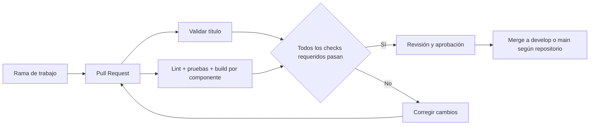

# CI/CD y flujos de trabajo de Go-Tacna

> **Estado:** Borrador operativo
> **Alcance:** describe lo que existe en los repositorios consultados y el proceso previsto; no implica que los flujos de producción ya estén automatizados.

## Resumen

- **CI** (integración continua): valida cambios —por ejemplo, formato, pruebas y compilación— antes de integrarlos.
- **CD** puede significar entrega continua (artefactos listos) o despliegue continuo (publicación automática). Go-Tacna aún no tiene un flujo de GitHub Actions verificado que construya y despliegue versiones a producción.
- El entorno local se levanta desde `go-tacna-infraestructura/docker-compose.yml`.
- El repositorio de infraestructura contiene manifiestos K3s/Kustomize para producción, pero el flujo descrito en su guía es **manual**. La instalación/despliegue en el VPS no se considera completada solo por tener los manifiestos.

## Qué está configurado hoy

| Repositorio | Automatización de GitHub Actions observada | Qué valida/ejecuta |
|---|---|---|
| `go-tacna-docs` | `.github/workflows/pr-title.yml` | Valida el formato del título del Pull Request |
| `go-tacna-backend` | `.github/workflows/pr-title.yml` | Valida el formato del título del Pull Request |
| `go-tacna-infraestructura` | `.github/workflows/pr-title.yml` | Valida el formato del título del Pull Request |
| `go-tacna-movil` | `.github/workflows/pr-title.yml` | Valida el formato del título del Pull Request |
| `go-tacna-frontend` | `.github/workflows/opencode.yml` | Ejecuta OpenCode ante comentarios que invocan `/oc` o `/opencode`; no es una CI de tests/build ni un despliegue |

**No se observaron workflows que ejecuten suites de pruebas, compilen todos los componentes, publiquen imágenes en GHCR o desplieguen a Contabo/K3s.** La configuración de protección de ramas en GitHub debe comprobarse aparte en Settings; la presencia del workflow de título no prueba que esté marcado como check obligatorio.

## Entorno local con Docker Compose

El Compose local integra PostgreSQL/PostGIS, Laravel Backend Core, Node/Socket.IO, frontend y Nginx gateway. Por defecto, el gateway se publica solamente en `127.0.0.1:8001` y PostgreSQL en `127.0.0.1:5432`. Los servicios internos se comunican en la red Compose.

Los repositorios de backend, frontend e infraestructura deben clonarse en rutas hermanas compatibles con `.env.example` de infraestructura. Si cambian, ajustar `BACKEND_PATH`, `LOCATION_PATH` o `FRONTEND_PATH` en el `.env` local.

En PowerShell:

```powershell
Set-Location ..\go-tacna-infraestructura
Copy-Item .env.example .env
docker compose config --quiet
docker compose up -d --build --wait
docker compose ps
docker compose logs -f
```

Para apagar conservando los datos locales:

```powershell
docker compose down
```

No usar `docker compose down -v` o `make clean` si se quiere conservar la base local: eliminan volúmenes y datos. Los valores del `.env.example` son exclusivamente para desarrollo; no reutilizarlos en producción.

La primera subida ejecuta migraciones y seeder según el entrypoint/Compose. Para revisar el estado:

```powershell
docker compose exec backend php artisan migrate:status
docker compose exec backend php artisan route:list --path=api/v1
```

En local, el gateway Compose usa el puerto `8001`. Ese puerto no se debe confundir con el NodePort K3s de producción.

## Flujo propuesto de CI para Pull Requests



La validación de título sí existe. Los checks de lint, pruebas y build en este diagrama son la **configuración recomendada por implementar**, usando los comandos declarados en cada repositorio y sin suponer que hoy corren en Actions:

- Backend Core: validar PHP/Laravel, formato, migraciones y pruebas PHPUnit/Pest configuradas.
- Location Service: `npm ci`, lint si está definido y tests reales. Hoy su `package.json` declara un script `test` que termina con “no test specified”; no tratarlo como suite aprobatoria.
- Frontend: `npm ci`, `npm run lint` y `npm run build`.
- Móvil: instalar dependencias y ejecutar los scripts configurados; validar tipos, lint y Expo Doctor si están disponibles.
- Infraestructura: validar `docker compose config --quiet` y Kustomize (`kubectl kustomize k8s/`) sin aplicar cambios al VPS.
- Documentación: validar enlaces internos y formato Markdown si se añade ese workflow.

Una vez configurados, hacer que los checks apropiados sean obligatorios para el merge junto con la aprobación exigida por las reglas de cada repo.

## Producción: estado y flujo manual de K3s

La infraestructura reporta un VPS Contabo con dominio y Nginx del host activos. Sin embargo, no se encontró un workflow de CD que publique imágenes o aplique los manifiestos. La guía del repositorio `go-tacna-infraestructura`, en `k8s/README.md`, indica que la instalación/despliegue K3s debe hacerse manualmente por SSH y que aún requiere imágenes publicadas y Secret. Ese archivo está en otro repositorio y la ruta no es un enlace Markdown navegable desde este repo.

El flujo previsto por esa guía es:

1. Revisar y aprobar el cambio; integrar a la rama de producción según las reglas del repositorio.
2. Ejecutar las validaciones de CI que se implementen. Hoy no hay un pipeline común de build/test configurado.
3. Construir y publicar imágenes versionadas en GHCR para Backend Core, frontend y Location Service. Usar tags inmutables (por ejemplo, el SHA del commit), no `latest`. **La publicación de imágenes no está automatizada actualmente** y el Location Service necesita su servidor de producción antes de empaquetarse.
4. Sustituir `REPLACE_WITH_TAG` en `k8s/backend.yaml`, `k8s/frontend.yaml` y `k8s/websocket.yaml`; revisar configuración y cambios de base de datos.
5. Antes de migrar producción, crear respaldo de PostgreSQL. Los manifiestos actuales no definen un Job de migraciones; añadir y probar un paso seguro de migración antes de considerar automatizado el despliegue.
6. Crear/actualizar el Secret `gotacna-secrets` directamente en el VPS o con un gestor seguro. No subir `.env`, claves ni tokens a Git.
7. Validar los manifiestos, revisar el diff y aplicar manualmente desde `go-tacna-infraestructura`:

   ```bash
   sudo k3s kubectl kustomize k8s/
   sudo k3s kubectl apply -k k8s/
   sudo k3s kubectl -n gotacna get pods,services,pvc
   sudo k3s kubectl -n gotacna rollout status statefulset/postgres
   sudo k3s kubectl -n gotacna rollout status deployment/backend
   ```

8. Validar frontend, API, WebSocket, healthchecks y logs; mantener el Nginx global apuntando al puerto de la modalidad desplegada.

### Puerto de upstream: verificar antes de publicar

Hay dos puertos diferentes en los archivos actuales:

| Entorno | Puerto en loopback del host | Estado |
|---|---:|---|
| Compose local | `127.0.0.1:8001` | Definido en `docker-compose.yml` |
| K3s | `127.0.0.1:30081` | NodePort definido en `k8s/gateway.yaml`; la guía K3s propone que Nginx del host lo use |

No cambiar el Nginx de producción a `30081` hasta confirmar que K3s está instalado, que el gateway está sano y que ese NodePort responde en el VPS. Si producción usa Compose, su gateway local es `8001`. Un `502 Bad Gateway` puede indicar que Nginx está apuntando a un upstream sin proceso escuchando; validar con el entorno realmente desplegado.

### Reversión

Si falla un rollout K3s, revisar primero el estado y logs. Los Deployments pueden revertirse con `kubectl rollout undo deployment/<nombre>` si la versión anterior de la imagen sigue disponible. Antes de una migración destructiva, restaurar desde el respaldo de PostgreSQL según el procedimiento aprobado. La reversión de imágenes no revierte automáticamente cambios incompatibles de esquema.

## Automatización de CD recomendada, todavía pendiente

Cuando las pruebas locales y la operación manual estén estables, el CD puede automatizarse por etapas:

1. Al mergear a la rama de producción, compilar y publicar imágenes etiquetadas con SHA en GHCR.
2. Actualizar referencias de imagen de forma revisable (PR de manifiestos o artefacto de release).
3. Pausar para aprobación en un GitHub Environment `production`.
4. Ejecutar migraciones como tarea controlada con respaldo previo.
5. Aplicar Kustomize/K3s mediante un mecanismo de despliegue restringido (runner self-hosted o acceso SSH de mínimo privilegio), y esperar los rollouts.
6. Ejecutar healthchecks y notificar el resultado; documentar rollback.

No crear un workflow con `kubectl apply` o SSH de producción hasta definir quién aprueba, dónde viven las credenciales, cómo se versionan imágenes, cómo se migran y respaldan datos y cuál puerto de upstream es el activo.
