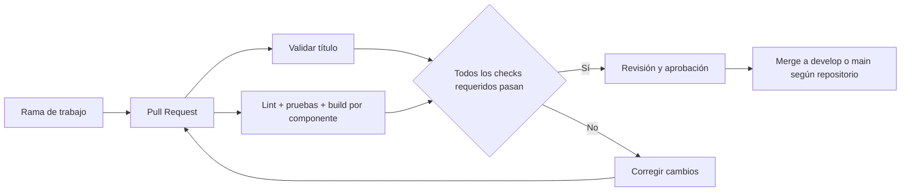

# CI/CD y flujos de trabajo de Go-Tacna

> **Estado:** Borrador operativo
> **Alcance:** describe lo que existe en los repositorios consultados, el entorno local y el despliegue manual actual en el VPS. No implica que la producción tenga integración o despliegue continuo automatizados.

## Resumen

- **CI** (integración continua): valida cambios —por ejemplo, formato, pruebas y compilación— antes de integrarlos.
- **CD** puede significar entrega continua (artefactos listos) o despliegue continuo (publicación automática). Go-Tacna aún no tiene un flujo de GitHub Actions verificado que construya y despliegue versiones a producción.
- El entorno local se levanta desde `go-tacna-infraestructura/docker-compose.yml`.
- La producción actual también usa **Docker Compose** en el VPS, con un `docker-compose.override.yml` local para `APP_ENV=production` y `APP_DEBUG=false`.
- K3s está instalado y activo en el VPS, pero **no se aplicaron los manifiestos de la aplicación**; los manifiestos K3s/Kustomize siguen siendo una alternativa no desplegada.
- El despliegue en producción es **manual por SSH**. La instalación de K3s o la presencia de manifiestos no se consideran un despliegue completado.

## Qué está configurado hoy

| Repositorio | Automatización de GitHub Actions observada | Qué valida/ejecuta |
|---|---|---|
| `go-tacna-docs` | `.github/workflows/pr-title.yml` | Valida el formato del título del Pull Request |
| `go-tacna-backend` | `.github/workflows/pr-title.yml` | Valida el formato del título del Pull Request |
| `go-tacna-infraestructura` | `.github/workflows/pr-title.yml` | Valida el formato del título del Pull Request |
| `go-tacna-movil` | `.github/workflows/pr-title.yml` | Valida el formato del título del Pull Request |
| `go-tacna-frontend` | `.github/workflows/opencode.yml` | Ejecuta OpenCode ante comentarios que invocan `/oc` o `/opencode`; no es una CI de tests/build ni un despliegue |

**No se observaron workflows que ejecuten suites de pruebas, compilen todos los componentes, publiquen imágenes en GHCR o desplieguen a Contabo.** La configuración de protección de ramas en GitHub debe comprobarse aparte en Settings; la presencia del workflow de título no prueba que esté marcado como check obligatorio.

## Entorno local con Docker Compose

El Compose integra PostgreSQL/PostGIS, Laravel Backend Core, Node/Socket.IO, frontend y Nginx gateway. Por defecto, el gateway se publica solamente en `127.0.0.1:8001` y PostgreSQL en `127.0.0.1:5432`. Los servicios internos se comunican en la red Compose.

Los repositorios de backend, frontend e infraestructura deben clonarse en rutas hermanas compatibles con `.env.example` de infraestructura. Si cambian, ajustar `BACKEND_PATH`, `LOCATION_PATH` o `FRONTEND_PATH` en el `.env` local.

En PowerShell:

```powershell
Set-Location ..\go-tacna-infraestructura
Copy-Item .env.example .env
docker compose config --quiet
docker compose up -d --build --wait
docker compose ps
docker compose logs -f
```

Para apagar conservando los datos locales:

```powershell
docker compose down
```

No usar `docker compose down -v` o `make clean` si se quiere conservar la base: eliminan volúmenes y datos. Los valores del `.env.example` son exclusivamente para desarrollo; no reutilizarlos en producción.

La primera subida ejecuta migraciones y seeder según el entrypoint/Compose. Para revisar el estado:

```powershell
docker compose exec backend php artisan migrate:status
docker compose exec backend php artisan route:list --path=api/v1
```

En local, el gateway Compose usa el puerto `8001`. En producción se usa el mismo puerto de loopback, pero detrás del Nginx del host con TLS.

## Flujo propuesto de CI para Pull Requests



La validación de título sí existe. Los checks de lint, pruebas y build en este diagrama son la **configuración recomendada por implementar**, usando los comandos declarados en cada repositorio y sin suponer que hoy corren en Actions:

- Backend Core: validar PHP/Laravel, formato, migraciones y pruebas PHPUnit/Pest configuradas.
- Location Service: `npm ci`, lint si está definido y tests reales. Hoy su `package.json` declara un script `test` que termina con “no test specified”; no tratarlo como suite aprobatoria.
- Frontend: `npm ci`, `npm run lint` y `npm run build`.
- Móvil: instalar dependencias y ejecutar los scripts configurados; validar tipos, lint y Expo Doctor si están disponibles.
- Infraestructura: validar `docker compose config --quiet` y, si se decide usar K3s, `kubectl kustomize k8s/` sin aplicar cambios al VPS.
- Documentación: validar enlaces internos y formato Markdown si se añade ese workflow.

Una vez configurados, hacer que los checks apropiados sean obligatorios para el merge junto con la aprobación exigida por las reglas de cada repo.

## Producción: Docker Compose y despliegue manual

### Estado actual

| Elemento | Valor |
|---|---|
| URL | `https://www.go-tacna.site/` |
| VPS | Contabo, `13.140.174.64` |
| Ruta | `/home/reverb/go-tacna` |
| Docker | Docker Engine 29.1.3 y Compose 2.40.3 |
| Servicios | `postgres`, `backend`, `gateway`, `websocket`, `frontend`, `nginx` |
| Entrada | Nginx del host `:80`/`:443` → `127.0.0.1:8001` |
| TLS | Let's Encrypt para `go-tacna.site` y `www.go-tacna.site` |
| CD | No configurado; despliegue manual por SSH |

El detalle de topología, requisitos y verificación está en [arquitectura/despliegue-produccion.md](arquitectura/despliegue-produccion.md) y en [INFRASTRUCTURE.md](INFRASTRUCTURE.md).

### Flujo manual de despliegue

1. Revisar y aprobar el cambio; integrarlo a la rama de trabajo correspondiente.
2. Entrar al VPS por SSH:

   ```bash
   ssh reverb@13.140.174.64
   cd /home/reverb/go-tacna
   ```

3. Actualizar los repositorios de aplicación e infraestructura:

   ```bash
   git -C go-tacna-frontend pull --ff-only
   git -C go-tacna-backend pull --ff-only
   git -C go-tacna-infraestructura pull --ff-only
   ```

4. Revisar la configuración sin imprimir secretos:

   ```bash
   cd go-tacna-infraestructura
   docker compose config --quiet
   ```

5. Si hay migraciones nuevas, crear un respaldo de PostgreSQL antes de continuar. No ejecutar `docker compose down -v`.
6. Construir y recrear los servicios:

   ```bash
   docker compose up -d --build --wait
   docker compose ps
   ```

7. Revisar logs y salud:

   ```bash
   docker compose logs --tail=100 backend gateway websocket nginx
   docker compose exec backend php artisan migrate:status
   ```

8. Verificar la web y la API desde fuera del servidor:

   ```bash
   curl -I https://www.go-tacna.site/
   curl -fsS 'https://www.go-tacna.site/api/v1/rutas?per_page=1'
   curl -fsS 'https://www.go-tacna.site/socket.io/?EIO=4&transport=polling'
   ```

9. Si cambió la configuración del Nginx del host:

   ```bash
   sudo nginx -t
   sudo systemctl reload nginx
   ```

### Nginx y TLS

El Nginx del host usa `/etc/nginx/sites-available/www.go-tacna.site` y proxy a `127.0.0.1:8001`. El dominio raíz se redirige a `www` desde `/etc/nginx/sites-available/default`; antes de modificarlo se creó el respaldo `/etc/nginx/sites-available/default.bak.20261023130649`.

El certificado se emite y renueva en el host con Certbot. No ejecutar Certbot ni publicar `80`/`443` desde el Compose de Go-Tacna.

### K3s: alternativa no activa

El VPS tiene K3s activo, pero los manifiestos de Go-Tacna no están aplicados. El NodePort `30081` de `k8s/gateway.yaml` **no es el upstream actual**. No cambiar el Nginx del host a `30081` sin desplegar y validar esa modalidad.

| Modalidad | Upstream | Estado |
|---|---|---|
| Docker Compose | `127.0.0.1:8001` | **Activo y verificado** |
| K3s | `127.0.0.1:30081` | Manifiestos presentes; no aplicado a la app |

### Reversión

Si falla una actualización:

1. Revisar `docker compose ps` y los logs del servicio afectado.
2. Volver al commit anterior en el repositorio correspondiente.
3. Reconstruir con `docker compose up -d --build --wait`.
4. Si el problema está en Nginx, restaurar el respaldo y validar con `nginx -t`.
5. Si hay cambios incompatibles de esquema, restaurar el respaldo de PostgreSQL.

La reversión de imágenes no revierte automáticamente cambios incompatibles de base de datos. El despliegue actual no tiene CD ni rollback automático.

## Automatización de CD recomendada, todavía pendiente

Cuando las pruebas locales y la operación manual estén estables, el CD puede automatizarse por etapas:

1. Al mergear a la rama de producción, compilar y publicar imágenes etiquetadas con SHA.
2. Actualizar referencias de imagen de forma revisable.
3. Pausar para aprobación en un GitHub Environment `production`.
4. Ejecutar migraciones como tarea controlada con respaldo previo.
5. Desplegar por SSH con Docker Compose, o por K3s si esa modalidad se adopta formalmente, y esperar los healthchecks.
6. Ejecutar verificaciones públicas y notificar el resultado; documentar el rollback.

No crear un workflow con `kubectl apply` o SSH de producción hasta definir quién aprueba, dónde viven las credenciales, cómo se versionan las imágenes, cómo se migran y respaldan los datos y cuál modalidad de despliegue es la activa.
