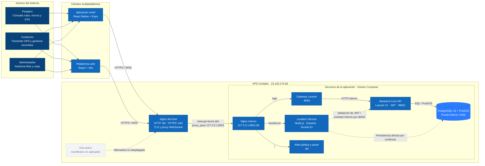

# Contexto y estado del proyecto Go-Tacna

Documento de referencia para dar continuidad al desarrollo y compartir el contexto del sistema con colaboradores y asistentes de IA. Resume la arquitectura, la infraestructura desplegada, los cinco repositorios y el estado conocido; distingue los servicios desplegados de las tareas todavía pendientes.

## 1. Visión general e infraestructura

- **Nombre oficial:** Go-Tacna. Las denominaciones anteriores Capaqñan y RutaTacna ya no se usan para este proyecto.
- **Propósito:** sistema de monitoreo GPS en tiempo real del transporte público de Tacna, Perú. Permite consultar rutas, ubicación de micros y tiempos estimados de llegada (ETA), y administrar la flota.
- **Roles:** Pasajero, Conductor y Administrador. El objetivo funcional es ofrecer acceso desde la web y la aplicación móvil; algunas pantallas y funciones todavía están en desarrollo.
- **Organización de GitHub:** `tuChaski`. El proyecto sigue una estrategia multirrepositorio con cinco repos independientes.

### Datos operativos reportados

| Elemento | Valor / estado |
|---|---|
| Proveedor del VPS | Contabo |
| IPv4 pública | `13.140.174.64` |
| URL canónica | `https://www.go-tacna.site/` |
| Dominio raíz | `https://go-tacna.site/` redirige con `301` a `www` |
| Dominios oficiales | `go-tacna.site` y `www.go-tacna.site` |
| TLS | Certificados Let's Encrypt activos para ambos nombres; renovación mediante Certbot |
| Proxy inverso | Nginx global del host; upstream `127.0.0.1:8001` |
| Despliegue | Docker Compose en el VPS; proyecto `gotacna-local` |
| K3s | Instalado y activo en el VPS, pero no participa en esta aplicación |
| Firewall UFW | Puertos públicos `80` (HTTP) y `443` (HTTPS) reportados como abiertos |

El proxy global escucha en los puertos públicos `80` y `443`. El Nginx del host reenvía el dominio a `127.0.0.1:8001`, donde el Nginx de Compose enruta `/` al frontend, `/api/` al gateway y `/socket.io/` al servicio de tiempo real. PostgreSQL se publica solo en loopback `127.0.0.1:5432` para mantenimiento. K3s sigue instalado, pero los manifiestos de la aplicación no están aplicados; el NodePort `30081` no es el upstream actual. El proceso local y de producción está en [CI-CD.md](CI-CD.md); el detalle de red, requisitos y operación está en [arquitectura/despliegue-produccion.md](arquitectura/despliegue-produccion.md) y en [INFRASTRUCTURE.md](INFRASTRUCTURE.md).

## 2. Stack y arquitectura de software

| Componente | Tecnología | Responsabilidad prevista |
|---|---|---|
| Backend Core (`gotacna-backend-core`) | Laravel 13, PHP 8.3 o superior | API REST, autenticación JWT, autorización por roles (RBAC), operaciones de gestión y lógica de negocio, incluido el ETA |
| Gateway (`gotacna-api-gateway`) | Laravel + proxy HTTP | Recibir el tráfico de la aplicación desde el Nginx interno y reenviarlo a la API |
| Servicio de ubicación (`go-tacna-location-service`) | Node.js, Express y Socket.IO | Recibir las coordenadas de los conductores —objetivo de frecuencia: cada 3 a 5 segundos— y distribuir actualizaciones en tiempo real a los clientes |
| Base de datos (`db`) | PostgreSQL 16 + PostGIS | Datos relacionales; PostGIS está habilitado, pero el esquema actual aún guarda trazados en texto y coordenadas en columnas numéricas. Puerto `5432` interno, no público |
| Plataforma web (`go-tacna-frontend`) | React, Vite y Tailwind CSS | Experiencia web responsive para consulta de rutas y operaciones según el rol |
| Aplicación móvil (`go-tacna-movil`) | React Native y Expo | Experiencia móvil multirol, mapa y modo Conductor con envío GPS, incluso en segundo plano cuando esté implementado |

El objetivo funcional prevé estimar el ETA a partir de distancia y velocidad; no se reporta como implementado en el avance actual y siempre debe presentarse como estimación, no como una hora garantizada. Backend Core persiste en PostgreSQL las posiciones recibidas por su endpoint HTTP; no se debe asumir que Location Service ya las persiste ni que su difusión Socket.IO está integrada con esa API.

### Avance de Backend Core al 15 de octubre de 2026

El Backend Core ya cuenta con migraciones, modelos, datos de prueba, autenticación JWT con control por roles y rutas REST para consulta y operaciones de conductor. Su endpoint HTTP persiste las posiciones recibidas. El inventario de entidades está en [arquitectura/modelo-de-datos.md](arquitectura/modelo-de-datos.md), los endpoints y el avance de implementación en [gotacna-backend-core.md](gotacna-backend-core.md).

PostGIS está habilitado, pero el esquema guarda trazados como texto y coordenadas en columnas numéricas, no como tipos `geometry`. La difusión de Location Service por Socket.IO aún no está integrada con esa persistencia; además, faltan pruebas funcionales específicas. Los claims JWT implementados y la diferencia con el contrato objetivo se documentan en [contratos/jwt-claims.md](contratos/jwt-claims.md).

El flujo local y de publicación se describe en [CI-CD.md](CI-CD.md).

### Despliegue web al 23 de octubre de 2026

La web pública y el panel están desplegados en `https://www.go-tacna.site/` con Docker Compose. Los seis servicios (`postgres`, `backend`, `gateway`, `websocket`, `frontend` y `nginx`) están saludables. El Nginx del host termina TLS y proxya a `127.0.0.1:8001`; el Nginx interno enruta `/`, `/api/` y `/socket.io/`.

La validación cubrió la landing, `/mapa`, `/login`, el login con rol `admin_general`, `/auth/me`, el panel `/admin/empresas`, las rutas `/api/v1/rutas` y `/api/v1/micros/activos`, y el handshake de Socket.IO. El frontend actual no consume Socket.IO: el mapa usa unidades simuladas sobre rutas reales. El detalle está en [arquitectura/despliegue-produccion.md](arquitectura/despliegue-produccion.md).

La documentación, los contratos y las decisiones transversales se mantienen en `go-tacna-docs`. La estructura completa del repositorio se enumera en la siguiente sección.

## 3. Matriz de repositorios y estructura documental

Los cinco repositorios oficiales de GitHub bajo `tuChaski` son:

```text
tuChaski/
├── go-tacna-docs/             # Documentación, contratos, arquitectura e informes
├── go-tacna-backend/          # Gateway, API Laravel y servicio de ubicación
├── go-tacna-frontend/         # Plataforma web
├── go-tacna-infraestructura/  # Compose, Nginx y manifiestos K3s/Kustomize
└── go-tacna-movil/            # Aplicación móvil React Native / Expo
```

### `go-tacna-docs`

Repositorio transversal para las especificaciones, la gobernanza y los entregables. Su árbol documental incluye:

| Carpeta | Contenido |
|---|---|
| `arquitectura/` | Arquitectura, modelo de datos, diagramas técnicos y decisiones |
| `casos-de-uso/` | Diagramas y especificaciones de casos de uso |
| `contratos/` | OpenAPI, eventos WebSocket y claims JWT |
| `diagramas/` | Fuentes Mermaid y exportaciones |
| `diseno/` | Guía visual, mapa del sitio, vistas y referencias |
| `general/` | Fichas de repositorios, configuración, checklist y decisiones pendientes |
| `guias/` | Guías transversales del equipo |
| `manuales/` | Guías de usuario y administración |
| `planificacion/` | Fases y planificación del proyecto |
| `pruebas/` | Plan de pruebas y matriz de trazabilidad |

Esta tabla refleja las carpetas presentes en el repositorio. `requisitos/`, `informe/`, `plantillas/` y `assets/` no están creadas actualmente; no se deben tratar como documentación disponible hasta que se incorporen.

### `go-tacna-backend`

Contiene tres componentes:

- `gotacna-api-gateway/`: componente destinado al proxy y la entrada a los servicios.
- `gotacna-backend-core/`: núcleo de la API en Laravel.
- `go-tacna-location-service/`: servicio Node.js para recepción y difusión de ubicaciones.

Backend Core ya cuenta con migraciones, modelos, autenticación y endpoints descritos arriba. El API Gateway y Location Service tienen guías propias; su estructura o configuración no implica que toda la integración entre servicios esté terminada.

### Los otros tres repositorios

- **`go-tacna-frontend`:** plataforma web React + Vite. El README del repositorio indica que todavía hay componentes del sistema dentro del monorepo original, por lo que la migración debe considerarse en curso hasta comprobar el contenido actual.
- **`go-tacna-movil`:** aplicación móvil React Native + Expo. El repositorio independiente está creado; la experiencia móvil completa, mapa y GPS en segundo plano siguen siendo trabajo de implementación.
- **`go-tacna-infraestructura`:** contiene Compose, configuración Nginx y manifiestos K3s/Kustomize. La aplicación está desplegada en el VPS con **Docker Compose**; K3s está instalado pero no se aplicaron los manifiestos de la app. El despliegue es manual y no tiene CD automatizado.

### Guías de contexto por componente

Para trabajar en un componente sin volver a reconstruir todo el contexto del sistema, consulta su guía específica:

- [API Gateway](gotacna-api-gateway.md)
- [Backend Core Laravel](gotacna-backend-core.md)
- [Location Service](go-tacna-location-service.md)
- [Frontend web](go-tacna-frontend.md)
- [Aplicación móvil](go-tacna-movil.md)

No se crea una guía de componente para infraestructura. Las configuraciones de Compose, Nginx o Kubernetes se entienden y mantienen junto con sus archivos; el contexto del host compartido está en [INFRASTRUCTURE.md](INFRASTRUCTURE.md).

## 4. Diagrama de arquitectura (Mermaid, nivel de contenedores)

Este diagrama usa Mermaid para que GitHub lo renderice directamente. La aplicación corre con Docker Compose en el VPS; el Nginx del host publica `80`/`443` y proxya a `127.0.0.1:8001`. K3s está instalado, pero sus manifiestos no están aplicados a esta aplicación.



El listener público TLS y los certificados pertenecen al Nginx del host. El Nginx interno de Compose usa `127.0.0.1:8001`; K3s define NodePort `30081`, pero no es la modalidad activa. Para múltiples proyectos, cada dominio debe apuntar a su propio puerto local y a su propio gateway.

## 5. Estado y próximos pasos conocidos

1. **Operar el despliegue actual:** mantener Docker Compose en `/home/reverb/go-tacna`, el Nginx del host apuntando a `127.0.0.1:8001` y TLS vigente para ambos dominios. Los cambios de código se aplican con `git pull` y reconstrucción de Compose.
2. **Completar CI/CD:** automatizar lint, pruebas, builds e imágenes; actualmente los workflows verificados no hacen build ni despliegue. Definir también respaldo de PostgreSQL y rollback.
3. **Completar Location Service:** definir servidor, eventos y contrato de JWT; conectar la difusión en tiempo real a las posiciones guardadas por Backend Core e integrar el cliente Socket.IO en la web.
4. **Completar pruebas del Backend Core:** cubrir migraciones, autenticación, roles, catálogo, perfil de conductor y registro de posiciones.
5. **Mantener los contratos como fuente de verdad:** cambios en API, WebSocket o JWT se documentan primero en `contratos/` y después se implementan en los repos consumidores.

Los dominios, dirección IP, certificados y estado de firewall de la sección 1 fueron verificados el 23 de octubre de 2026. Confirmar su vigencia antes de realizar cambios en producción. No se incluyen credenciales ni secretos en este documento.
