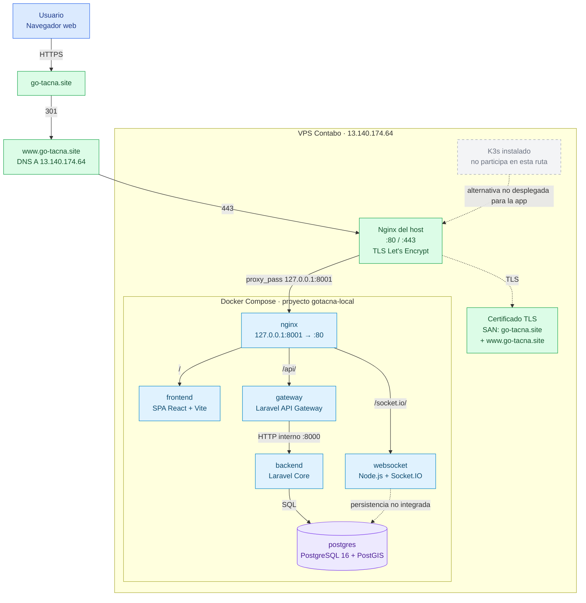
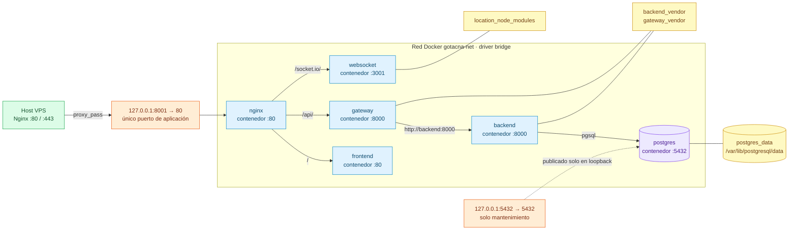
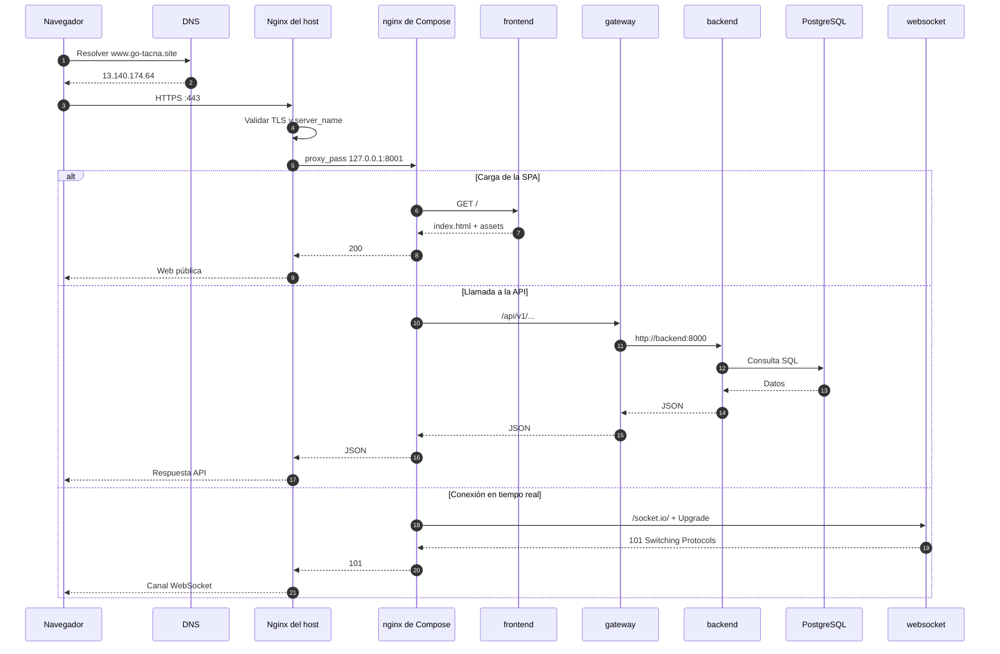
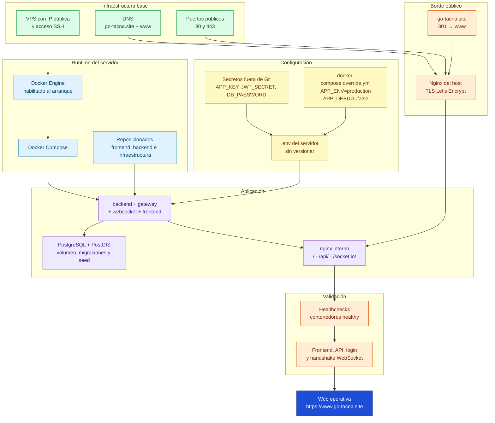

# Despliegue de producción

> **Estado:** En revisión
> **Responsable:** Royfrankly Navarro
> **Última verificación:** 23 de octubre de 2026
> **Relacionado:** [INFRASTRUCTURE.md](../INFRASTRUCTURE.md), [CI-CD.md](../CI-CD.md), [configuracion.md](../general/configuracion.md), [checklist.md](../general/checklist.md)

Este documento describe el despliegue **real** de Go-Tacna en el VPS de Contabo y los requisitos que deben cumplirse para que la web pública y el panel de administración estén operativos. No describe una instalación hipotética: la topología, los puertos y los servicios corresponden a la verificación realizada el 23 de octubre de 2026.

## 1. Resumen operativo

| Elemento | Valor |
|---|---|
| URL canónica | `https://www.go-tacna.site/` |
| Dominio raíz | `https://go-tacna.site/` redirige con `301` a `www` |
| VPS | Contabo, IP pública `13.140.174.64` |
| Sistema de despliegue | Docker Compose desde `go-tacna-infraestructura` |
| Ruta del proyecto | `/home/reverb/go-tacna` |
| Proxy público | Nginx del host, puertos `80` y `443` |
| Upstream de la aplicación | `127.0.0.1:8001` |
| Base de datos | PostgreSQL 16 + PostGIS, contenedor `postgres` |
| TLS | Let's Encrypt; el certificado incluye `go-tacna.site` y `www.go-tacna.site` |
| Estado de contenedores | Los seis servicios responden y están `healthy` |
| K3s | Instalado y activo en el VPS, pero **no participa** en esta aplicación |

El proyecto Compose conserva el nombre histórico `gotacna-local`. Ese nombre no significa que sea un entorno local: es el nombre del proyecto Docker y aparece en los nombres de contenedores, redes y volúmenes.

## 2. Topología de despliegue

El tráfico público entra por el Nginx del host, que termina TLS y reenvía todo el dominio a un único puerto de loopback. El Nginx interno de Compose separa las rutas de la aplicación.

```text
Internet
  └─ DNS: go-tacna.site / www.go-tacna.site
       └─ Nginx del host :80 / :443
            └─ 127.0.0.1:8001
                 └─ nginx de Compose
                      ├─ /            → frontend:80
                      ├─ /api/        → gateway:8000 → backend:8000
                      └─ /socket.io/  → websocket:3001
```

El Nginx del host es el único proceso que escucha en interfaces públicas. La aplicación no publica `80` ni `443` directamente. PostgreSQL se publica solo en `127.0.0.1:5432` para mantenimiento y el gateway de Compose se publica solo en `127.0.0.1:8001`; ninguno de los dos queda expuesto a Internet.

### Diagrama general

La fuente editable está en [despliegue-produccion.mmd](despliegue-produccion.mmd).



## 3. Red Docker, puertos y volúmenes

La red `gotacna-net` es una red bridge privada de Compose. Todos los servicios se resuelven por nombre dentro de esa red: `gateway` llama a `http://backend:8000`, el Nginx interno llama a `frontend:80`, `gateway:8000` y `websocket:3001`, y el backend usa `postgres:5432`.

La fuente editable está en [red-docker-produccion.mmd](red-docker-produccion.mmd).



| Recurso | Tipo | Uso |
|---|---|---|
| `gotacna-net` | Red bridge | Comunicación privada entre servicios |
| `127.0.0.1:8001` | Puerto publicado | Entrada del Nginx interno; solo loopback |
| `127.0.0.1:5432` | Puerto publicado | Mantenimiento de PostgreSQL; solo loopback |
| `postgres_data` | Volumen | Datos persistentes de PostgreSQL |
| `backend_vendor` | Volumen | Dependencias PHP del backend |
| `gateway_vendor` | Volumen | Dependencias PHP del gateway |
| `location_node_modules` | Volumen | Dependencias Node del websocket |

El código del backend, gateway y websocket se monta mediante bind mounts desde los repositorios hermanos. El frontend se compila dentro de su imagen. Por eso, un cambio de código no se aplica solo con `git pull`: hay que reconstruir y recrear los servicios afectados.

## 4. Flujo de una petición

La fuente editable está en [flujo-peticion-produccion.mmd](flujo-peticion-produccion.mmd).



El Nginx interno reenvía el host y el esquema originales mediante `X-Forwarded-Host` y `X-Forwarded-Proto`. Esto es necesario para que Laravel construya URLs y redirecciones con `https://www.go-tacna.site` y no con el host interno del contenedor.

## 5. Requisitos para que la web esté operativa

La fuente editable está en [requisitos-web-operativa.mmd](requisitos-web-operativa.mmd).



### 5.1 Infraestructura y red

- [x] VPS con IP pública y acceso SSH.
- [x] DNS de `go-tacna.site` apuntando a `13.140.174.64`.
- [x] `www.go-tacna.site` resolviendo al mismo VPS.
- [x] Puertos `80` y `443` accesibles desde Internet.
- [x] Certificado TLS con ambos nombres en el SAN.
- [x] Redirección `301` del dominio raíz a `www`.

### 5.2 Runtime y aplicación

- [x] Docker Engine y Docker Compose instalados.
- [x] Docker habilitado al arranque del sistema.
- [x] Usuario de despliegue con acceso al daemon de Docker.
- [x] Repositorios de frontend, backend e infraestructura clonados en `/home/reverb/go-tacna`.
- [x] Imágenes construidas y servicios levantados con `docker compose up -d --build --wait`.
- [x] PostgreSQL/PostGIS con volumen persistente, migraciones y datos de demostración.
- [x] Servicios con `restart: unless-stopped` y healthchecks.

### 5.3 Configuración y secretos

- [x] `.env` de producción en el servidor, fuera de Git.
- [x] `APP_ENV=production` y `APP_DEBUG=false` mediante override local.
- [x] `APP_URL=https://www.go-tacna.site`.
- [x] Orígenes CORS restringidos al dominio público.
- [x] `VITE_API_BASE_URL=/api/v1` y `VITE_WS_URL=https://www.go-tacna.site` en el build del frontend.
- [x] Permisos restringidos para `.env` y el override.
- [ ] Configurar respaldo automático de PostgreSQL.
- [ ] Configurar un gestor de secretos o respaldo seguro de las claves.

### 5.4 Borde público

- [x] Nginx del host escuchando en `80` y `443`.
- [x] `proxy_pass` a `127.0.0.1:8001`.
- [x] Cabeceras `Upgrade` y `Connection` para WebSocket.
- [x] Renovación de TLS gestionada en el host con Certbot.
- [x] Nginx validado con `nginx -t` y recargado sin errores.

## 6. Configuración de producción

Las variables se definen en el `.env` del servidor y no se versionan. En esta tabla se documenta su propósito, no sus valores secretos.

| Variable | Valor o uso |
|---|---|
| `APP_ENV` | `production` |
| `APP_DEBUG` | `false` |
| `APP_URL` | `https://www.go-tacna.site` |
| `APP_KEY` | Clave de Laravel; obligatoria, no se documenta |
| `JWT_SECRET` | Secreto compartido por API y servicios; no se documenta |
| `DB_DATABASE` | Base de datos de Go-Tacna |
| `DB_USERNAME` | Usuario de PostgreSQL |
| `DB_PASSWORD` | Contraseña de PostgreSQL; se conservó el secreto del entorno local según indicación del equipo, sin publicarlo |
| `DB_PUBLISHED_PORT` | `5432`, solo en `127.0.0.1` |
| `CORS_ALLOWED_ORIGINS` | `https://www.go-tacna.site,https://go-tacna.site` |
| `CORS_ORIGIN` | `https://www.go-tacna.site` |
| `VITE_API_BASE_URL` | `/api/v1` |
| `VITE_WS_URL` | `https://www.go-tacna.site` |
| `SEED_DEMO_DATA` | `true` en la presentación; debe pasar a `false` para una producción real |
| `GATEWAY_PUBLISHED_PORT` | `8001`, solo en `127.0.0.1` |

El `docker-compose.override.yml` del servidor aplica `APP_ENV=production` y `APP_DEBUG=false` a los servicios PHP. Es un archivo local del despliegue y no se versiona.

## 7. Despliegue paso a paso

### 7.1 Preparar el servidor

```bash
ssh reverb@13.140.174.64
mkdir -p /home/reverb/go-tacna
cd /home/reverb/go-tacna
git clone <url-frontend> go-tacna-frontend
git clone <url-backend> go-tacna-backend
git clone <url-infraestructura> go-tacna-infraestructura
```

Los tres repositorios deben quedar en rutas hermanas porque el Compose los referencia con `BACKEND_PATH`, `GATEWAY_PATH`, `LOCATION_PATH` y `FRONTEND_PATH`.

### 7.2 Configurar el entorno

```bash
cd /home/reverb/go-tacna/go-tacna-infraestructura
cp .env.example .env
chmod 600 .env
```

Editar `.env` con los valores de producción: dominio, base de datos, claves, CORS y URLs del frontend. Crear también `docker-compose.override.yml` con `APP_ENV=production` y `APP_DEBUG=false`. Nunca subir ninguno de esos dos archivos a Git.

### 7.3 Construir y levantar

```bash
docker compose config --quiet
docker compose up -d --build --wait
docker compose ps
```

El entrypoint del backend ejecuta las migraciones y el seeder idempotente. No usar `docker compose down -v` ni eliminar el volumen `postgres_data`: eso borra la base de datos.

### 7.4 Publicar el dominio

El Nginx del host usa `/etc/nginx/sites-available/www.go-tacna.site` con `proxy_pass http://127.0.0.1:8001`. El dominio raíz se atiende en `/etc/nginx/sites-available/default` y responde con `301` hacia `www`.

```bash
sudo nginx -t
sudo systemctl reload nginx
```

Antes de cambiar la configuración del host se creó el respaldo `/etc/nginx/sites-available/default.bak.20261023130649`. El certificado se emite y renueva en el host, no dentro de Compose.

## 8. Verificación

| Comprobación | Resultado esperado |
|---|---|
| `docker compose ps` | Seis servicios `healthy` |
| `https://www.go-tacna.site/` | `200` y título de Go-Tacna |
| `https://www.go-tacna.site/mapa` | `200`; mapa y rutas cargadas |
| `https://www.go-tacna.site/login` | `200`; formulario de acceso |
| `https://www.go-tacna.site/api/v1/rutas` | `200` con datos |
| `https://www.go-tacna.site/api/v1/micros/activos` | `200` con micros activos |
| Login y `/api/v1/auth/me` | `200`; sesión válida |
| `/socket.io/?EIO=4&transport=polling` | Handshake con `sid` |
| `https://go-tacna.site/` | `301` hacia `www` |
| Navegador | Sin errores de consola ni excepciones |

Comandos de referencia:

```bash
curl -I https://www.go-tacna.site/
curl -fsS 'https://www.go-tacna.site/api/v1/rutas?per_page=1'
curl -fsS 'https://www.go-tacna.site/socket.io/?EIO=4&transport=polling'
```

## 9. Operación diaria

```bash
cd /home/reverb/go-tacna/go-tacna-infraestructura

docker compose ps
docker compose logs -f --tail=100
docker compose logs -f backend
docker compose exec backend php artisan migrate:status
docker compose exec backend php artisan route:list --path=api/v1
```

Para reiniciar un servicio sin tocar los datos:

```bash
docker compose restart backend gateway websocket frontend nginx
```

Para aplicar una actualización de código:

```bash
cd /home/reverb/go-tacna
git -C go-tacna-frontend pull --ff-only
git -C go-tacna-backend pull --ff-only
git -C go-tacna-infraestructura pull --ff-only
cd go-tacna-infraestructura
docker compose up -d --build --wait
```

## 10. Actualización y reversión

Antes de una migración o cambio de esquema:

1. Crear un respaldo de PostgreSQL y guardarlo fuera del volumen del contenedor.
2. Revisar el diff y las migraciones nuevas.
3. Ejecutar `docker compose up -d --build --wait`.
4. Verificar salud, logs y endpoints.

Si el problema está en Nginx, restaurar el respaldo correspondiente y validar con `nginx -t` antes de recargar. Si el problema está en una versión de la aplicación, volver al commit anterior y reconstruir:

```bash
git checkout <commit-anterior>
docker compose up -d --build --wait
```

La reversión de imágenes no revierte cambios incompatibles de base de datos. Para eso hay que restaurar el respaldo de PostgreSQL. El despliegue actual es manual; no existe un pipeline de CD que haga esto automáticamente.

## 11. Limitaciones y deuda operativa

- **WebSocket sin cliente en la web:** el servicio `websocket` está desplegado y responde el handshake, pero el frontend actual no tiene un cliente Socket.IO. El mapa usa unidades simuladas sobre rutas reales. La conexión en vivo queda pendiente de integración.
- **Datos de demostración:** `SEED_DEMO_DATA=true` carga datos de demo en cada arranque. Para producción real debe cambiarse a `false` y decidir si se limpian los datos sembrados.
- **Sin CD automático:** el despliegue se ejecuta manualmente por SSH. Los workflows actuales no construyen ni publican la aplicación.
- **Sin respaldo automático:** el volumen `postgres_data` persiste, pero no se configuró una política de respaldo.
- **Imágenes locales:** los servicios PHP usan la etiqueta local `gotacna-php:local`; no hay registro de imágenes ni etiquetas inmutables por commit.
- **Nombre histórico:** el proyecto Compose se llama `gotacna-local` aunque se ejecute en producción.
- **K3s no utilizado:** K3s está activo en el VPS, pero no se aplicaron los manifiestos de esta aplicación. No cambiar el upstream de Nginx a `30081` sin desplegar y validar esa modalidad.

## 12. Docker Compose frente a K3s

| Aspecto | Docker Compose (actual) | K3s (alternativa) |
|---|---|---|
| Estado | Desplegado y verificado | Instalado en el VPS, no usado por la app |
| Entrada | `127.0.0.1:8001` | NodePort `30081` en los manifiestos |
| Servicios | `postgres`, `backend`, `gateway`, `websocket`, `frontend`, `nginx` | Manifiestos Kustomize del repo de infraestructura |
| Persistencia | Volumen `postgres_data` | PVC definido en manifiestos |
| Operación | `docker compose` por SSH | `kubectl`/Kustomize, flujo manual |
| Nginx host | Apunta a `8001` | Solo si se activa, apuntaría a `30081` |

La existencia de manifiestos K3s no significa que estén aplicados. La modalidad vigente es Compose.

## 13. Referencias

- [Infraestructura del VPS](../INFRASTRUCTURE.md)
- [CI/CD y flujos de trabajo](../CI-CD.md)
- [Configuración general](../general/configuracion.md)
- [Checklist de puesta en marcha](../general/checklist.md)
- [Arquitectura del sistema](arquitectura.md)
- [Diagrama general de despliegue](despliegue-produccion.mmd)
- [Red Docker de producción](red-docker-produccion.mmd)
- [Flujo de una petición](flujo-peticion-produccion.mmd)
- [Requisitos para la web operativa](requisitos-web-operativa.mmd)
