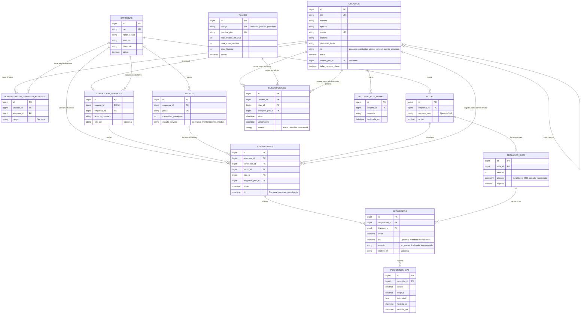

# Modelo de datos
> **Estado:** En revisión — propuesta de 13 tablas, pendiente de implementación en el backend
> **Responsable:** Alex Huaracha Bellido (propuesta), equipo de backend (revisión e implementación)
> **Relacionado:** [Fuente del diagrama](../diagramas/fuente/modelo-entidad-relacion.mmd), [Backend Core](../gotacna-backend-core.md), [Arquitectura](arquitectura.md)

## Alcance y situación actual

Esta propuesta define las cuentas, la administración de empresas, las asignaciones de conductores, los recorridos con GPS y los beneficios del pasajero. El cambio se realiza en la documentación de `go-tacna-docs`.

La base de referencia implementa nueve tablas de dominio. Su descripción se conserva en la [versión anterior del modelo](https://github.com/tuChaski/go-tacna-docs/blob/df9bac4bd25048e6c77a5bab89e387ef1fc69509/arquitectura/modelo-de-datos.md) y en las [migraciones del backend revisado](https://github.com/tuChaski/go-tacna-backend/tree/6d7c4a95def2ff5075ceae553549322d0838a173/gotacna-backend-core/database/migrations). Las reglas de este documento describen el comportamiento propuesto y requieren implementación y pruebas.

| Grupo | Tablas de la propuesta |
|---|---|
| Cuentas y empresas | `usuarios`, `empresas`, `administrador_empresa_perfiles`, `conductor_perfiles` |
| Flota y seguimiento | `micros`, `rutas`, `trazados_ruta`, `asignaciones`, `recorridos`, `posiciones_gps` |
| Acceso del pasajero | `planes`, `suscripciones`, `historial_busquedas` |

Se incorporan cuatro tablas: `trazados_ruta`, `asignaciones`, `recorridos` e `historial_busquedas`. Las tablas técnicas de Laravel quedan fuera del diagrama de dominio.

## Funcionamiento acordado

- El administrador general crea las cuentas de administradores de empresa, gestiona usuarios y configura los planes.
- El administrador de empresa registra sus conductores y sus credenciales, micros, rutas y asignaciones. Su dashboard consulta toda su flota autorizada.
- Un conductor pertenece a una empresa a la vez y puede cambiar de micro mediante una nueva asignación.
- Cada ruta pertenece a una empresa. Una empresa puede operar varias rutas.
- La ruta 10B, por ejemplo, tiene un circuito completo por la ciudad que vuelve a su punto de salida. El trazado conserva el orden y el sentido de circulación, incluidos los tramos compartidos.
- El conductor puede iniciar el seguimiento desde cualquier punto y finalizarlo mediante un botón. Un recorrido registra esa sesión y puede abarcar un tramo, una vuelta o varias vueltas.
- El punto base corresponde a la primera y última coordenada del circuito. La posición real de inicio del seguimiento queda en sus muestras GPS.
- Premium queda preparado mediante límites configurables y suscripciones con vencimiento. La activación manual por el administrador general es la propuesta para pruebas. El cobro de pasajes y la integración con medios de pago quedan fuera del alcance.
- La ocupación del micro y los paraderos intermedios se consideran ampliaciones futuras.

## Relaciones

Los nombres del diagrama corresponden a las tablas indicadas en minúsculas. `PK` identifica la clave primaria, `FK` una referencia y `UK` un valor único. `||` representa uno, `o|` representa cero o uno y `o{` representa cero o varios.

El diagrama muestra relaciones a lo largo del tiempo. Los límites de una asignación vigente y un recorrido abierto se detallan en las reglas de integridad.

## Campos del modelo propuesto

Todas las tablas tienen `id` como PK `bigint` y las marcas `created_at` y `updated_at`. Las FK usan el mismo tipo que la PK referenciada. Los campos son obligatorios salvo indicación de que admiten nulos. Los instantes se almacenan en UTC y se convierten a la hora local en la interfaz. Los tamaños definitivos y las restricciones físicas se concretan en las migraciones posteriores.

### usuarios

| Campo | Definición |
|---|---|
| `dni` | Texto único. Se conserva el requisito actual de identificación. |
| `nombre`, `apellido` | Datos de identidad de la cuenta. |
| `correo` | Texto único utilizado para iniciar sesión. |
| `telefono` | Teléfono de contacto. |
| `password_hash` | Hash de la contraseña, excluido de las respuestas públicas. |
| `rol` | `pasajero`, `conductor`, `admin_general` o `admin_empresa`. |
| `activo` | Habilita el acceso de la cuenta. |
| `creado_por_id` | FK a `usuarios.id`, admite nulos para autorregistro, cuenta inicial o procedencia desconocida. |
| `debe_cambiar_clave` | Verdadero para una cuenta creada con contraseña temporal. |

El registro público crea pasajeros. El administrador general crea cuentas administrativas y el administrador de empresa crea conductores dentro de su empresa. La identidad del creador procede de la sesión autorizada. El rol y la empresa se validan en el servidor.

### empresas

| Campo | Definición |
|---|---|
| `ruc` | Texto único. |
| `razon_social` | Nombre legal de la empresa. |
| `telefono`, `direccion` | Datos de contacto. |
| `activo` | Habilita la operación de la empresa. |

### administrador_empresa_perfiles

| Campo | Definición |
|---|---|
| `usuario_id` | FK a `usuarios.id`. La cuenta debe tener el rol `admin_empresa`. |
| `empresa_id` | FK a `empresas.id`. |
| `cargo` | Texto opcional, admite nulos. |

La pareja `(usuario_id, empresa_id)` es única. Se conserva la posibilidad actual de varios administradores por empresa y varias empresas autorizadas por administrador.

### conductor_perfiles

| Campo | Definición |
|---|---|
| `usuario_id` | FK única a `usuarios.id`. La cuenta debe tener el rol `conductor`. |
| `empresa_id` | FK a `empresas.id`. Empresa actual del conductor. |
| `licencia_conducir` | Identificación de la licencia. |
| `foto_url` | Referencia a la foto, admite nulos. |

La ficha pública muestra nombre, foto disponible y empresa del conductor del recorrido seleccionado. Los campos de identidad y contacto administrativos se reservan para los permisos correspondientes. El estado operativo se obtiene del recorrido abierto y de la actualización del GPS.

### micros

| Campo | Definición |
|---|---|
| `empresa_id` | FK a `empresas.id`. |
| `placa` | Texto único. |
| `capacidad_pasajeros` | Entero mayor que cero. |
| `estado_servicio` | `operativo`, `mantenimiento` o `inactivo`. |

La asignación vigente determina conductor y ruta actuales. Un micro puede registrarse antes de tener asignación. El recorrido abierto determina si está en recorrido y la hora de las muestras GPS permite mostrar su conectividad.

### rutas

| Campo | Definición |
|---|---|
| `empresa_id` | FK a `empresas.id`. |
| `nombre_ruta` | Texto que identifica la ruta, por ejemplo `10B` o `14`. |
| `activo` | Habilita su operación. |

La pareja `(empresa_id, nombre_ruta)` es única. Los micros de una misma ruta consultan el trazado de esa ruta.

### trazados_ruta — nueva

| Campo | Definición |
|---|---|
| `ruta_id` | FK a `rutas.id`. |
| `version` | Entero positivo. La pareja `(ruta_id, version)` es única. |
| `circuito` | Geometría `LineString` con SRID 4326. Secuencia completa y ordenada del circuito. |
| `vigente` | Identifica la versión disponible para iniciar nuevos recorridos. |

El circuito tiene longitud mayor que cero y sus coordenadas inicial y final coinciden en la base habitual. Admite cruces y tramos repetidos. GeoJSON expresa las coordenadas como `[longitud, latitud]`.

Una ruta operativa tiene una versión vigente. Cuando cambia el camino se crea otra versión. La geometría de una versión utilizada se conserva para consultar los recorridos anteriores. El backend actual utiliza PostGIS en PostgreSQL y JSON en SQLite para los trazados, distinción que debe contemplar la implementación.

### asignaciones — nueva

| Campo | Definición |
|---|---|
| `empresa_id` | FK a `empresas.id`. Conserva la empresa responsable de esa asignación. |
| `conductor_id` | FK a `conductor_perfiles.id`. |
| `micro_id` | FK a `micros.id`. |
| `ruta_id` | FK a `rutas.id`. |
| `asignado_por_id` | FK a `usuarios.id`. Administrador autorizado que registra la asignación. |
| `inicio` | Instante en que se abre la asignación. |
| `fin` | Instante de cierre, admite nulos mientras siga vigente. |

Ejemplo: el lunes José conduce el micro A en la ruta 10B. El martes se registra otra asignación para el micro B. La asignación del lunes permanece disponible para consultar sus recorridos.

### recorridos — nueva

| Campo | Definición |
|---|---|
| `asignacion_id` | FK a `asignaciones.id`. Determina empresa, conductor, micro y ruta. |
| `trazado_id` | FK a `trazados_ruta.id`. Versión usada al iniciar el recorrido. |
| `inicio` | Instante aceptado por el servidor al pulsar «Iniciar». |
| `fin` | Instante de cierre, admite nulos durante el recorrido. |
| `estado` | `en_curso`, `finalizado` o `interrumpido`. |
| `motivo_fin` | Texto opcional para explicar el cierre o una interrupción. |

Iniciar desde cualquier punto es válido. La cantidad de recorridos indica sesiones iniciadas y finalizadas. Contar vueltas completas requiere una regla adicional de detección. Una caída de conexión mantiene el recorrido abierto hasta su cierre explícito o hasta aplicar una política de cierre que se defina posteriormente.

### posiciones_gps

| Campo | Definición |
|---|---|
| `recorrido_id` | FK a `recorridos.id`. |
| `latitud` | Decimal entre -90 y 90. |
| `longitud` | Decimal entre -180 y 180. |
| `velocidad` | Número mayor o igual que cero. La unidad se documentará en el contrato de la API. |
| `medida_en` | Instante de la lectura en el dispositivo. |
| `recibida_en` | Instante de recepción asignado por el servidor. |

El micro y el conductor se obtienen a través del recorrido y su asignación. Una muestra atrasada conserva su hora de medición y debe evitar que la ubicación mostrada retroceda a un dato anterior. Los reintentos requieren deduplicación en el contrato de envío que se acuerde al implementar.

### planes

| Campo | Definición |
|---|---|
| `codigo` | Texto único, inicialmente `invitado`, `gratuito` o `premium`. |
| `nombre_plan` | Nombre visible único. |
| `max_micros_en_vivo` | Entero positivo. |
| `max_rutas_visibles` | Entero positivo. |
| `dias_historial` | Entero mayor o igual que cero. |
| `activo` | Habilita el uso del plan. |

| Acceso | Micros simultáneos | Rutas simultáneas | Días de historial |
|---|---:|---:|---:|
| Invitado | 1 | 1 | 0 |
| Cuenta gratuita | 3 | 3 | 7 |
| Premium | 6 | 6 | 30 |

Los límites son configurables y corresponden a las selecciones simultáneas. Una ruta cuenta como un circuito completo. El pasajero puede buscar otras rutas y cambiar la selección.

El invitado usa la configuración sin cuenta persistente. El pasajero registrado recibe el acceso gratuito por defecto. Una suscripción premium vigente amplía esos beneficios. La administración de flota tiene acceso a todos los micros de sus empresas autorizadas.

### suscripciones

| Campo | Definición |
|---|---|
| `usuario_id` | FK a `usuarios.id`. Pasajero beneficiario. |
| `plan_id` | FK a `planes.id`. Plan premium otorgado. |
| `otorgada_por_id` | FK a `usuarios.id`. Administrador general que habilita el acceso. |
| `inicio` | Inicio de la vigencia. |
| `vencimiento` | Fin de la vigencia, posterior al inicio. |
| `estado` | `activa`, `vencida` o `cancelada`. |

La propuesta para pruebas es una activación manual con vencimiento. El servidor determina el acceso efectivo a partir del estado, la vigencia y la disponibilidad del plan. Al vencer o cancelarse el beneficio se aplica el plan gratuito. El pasajero consulta sus propias suscripciones.

### historial_busquedas — nueva

| Campo | Definición |
|---|---|
| `usuario_id` | FK a `usuarios.id`. Propietario de la búsqueda. |
| `consulta` | Texto consultado. |
| `realizada_en` | Instante en que se realiza la búsqueda. |

El pasajero consulta y elimina su propio historial. Las consultas aplican inmediatamente la ventana de días de su plan vigente. Una tarea de limpieza elimina los registros fuera de esa ventana. Ampliar el plan permite conservar nuevas búsquedas por más tiempo y las búsquedas ya eliminadas siguen eliminadas. La retención del GPS de la flota requiere una política propia.

## Integridad y permisos

Estas reglas complementan las FK del diagrama y se implementan en el servidor y en las restricciones de base de datos que correspondan.

| Operación | Regla |
|---|---|
| Abrir una asignación | Cuenta y empresa activas, micro operativo y ruta activa. Conductor, micro y ruta pertenecen a la empresa de la asignación. El administrador tiene permiso sobre ella. |
| Asignaciones simultáneas | Los periodos de un mismo conductor o micro no se solapan. Existe como máximo una asignación abierta por conductor y por micro. |
| Cerrar una asignación | `fin > inicio` y todos sus recorridos están cerrados. Los recorridos quedan dentro del periodo de la asignación. |
| Cambiar conductor, micro o ruta | Se cierra el recorrido abierto y la asignación anterior, y se registra otra asignación. Las referencias de una asignación utilizada se conservan. |
| Cambiar de empresa | Se cierran las asignaciones vigentes antes del traslado. Las asignaciones anteriores conservan su empresa. Su consulta se autoriza por esa empresa histórica. |
| Iniciar un recorrido | Asignación vigente, conductor autenticado correspondiente, cuenta y empresa activas, micro operativo y ruta activa. Se usa el trazado vigente de esa ruta. |
| Recorridos simultáneos | Existe como máximo un recorrido abierto por asignación. La comprobación y la apertura deben ser atómicas ante solicitudes concurrentes. |
| Finalizar un recorrido | Se registra `fin >= inicio` y el estado de cierre. Repetir la solicitud conserva el cierre ya registrado. `en_curso` implica `fin` nulo y los otros estados requieren `fin`. |
| Recibir GPS | La muestra corresponde al conductor autorizado y al periodo de su recorrido. Las lecturas de un recorrido ya cerrado no reactivan el seguimiento. |
| Consultar ubicación | Se informa la hora de la última lectura. El umbral para marcar una ubicación como desactualizada queda pendiente de acordar. |
| Cambiar el trazado | Se conserva la versión utilizada y se activa la nueva versión de forma atómica. Una ruta tiene como máximo una versión vigente. |
| Otorgar premium | El otorgante es administrador general. Las suscripciones habilitadas de un pasajero no solapan su vigencia. |
| Consultar beneficios | Se verifica `inicio <= ahora < vencimiento`, estado y plan activo, incluso si todavía no se actualiza el estado almacenado a `vencida`. |
| Aplicar límites | La API y el servicio de seguimiento verifican las selecciones autorizadas y los beneficios de la sesión. |
| Desactivar cuentas o empresas | Se impide nuevo acceso y seguimiento. La implementación debe coordinar la revocación de sesiones y el cierre de recorridos afectados. |
| Conservar historial | Se restringe el borrado de cuentas, empresas, perfiles, micros, rutas, trazados y asignaciones referenciados. La eliminación de búsquedas y la retención del GPS se gestionan según sus políticas específicas. |

Índices propuestos: parejas únicas en vínculos administrativos, rutas y versiones de trazado, unicidad de la versión vigente por ruta, índices temporales para asignaciones por conductor y micro, recorridos por asignación, GPS por `(recorrido_id, medida_en)` y búsquedas por `(usuario_id, realizada_en)`. Los controles de periodos deben cubrir concurrencia y registros históricos además de los registros abiertos.

## Transición desde las nueve tablas actuales

| Modelo implementado | Modelo propuesto y tratamiento |
|---|---|
| `micros.conductor_actual_id` y `micros.ruta_id` | La asignación vigente determina conductor y ruta. Los vínculos existentes solo acreditan la situación conocida al migrar. |
| `micros.estado` y `conductor_perfiles.estado_operativo` | El estado de servicio se separa del recorrido abierto y de la frescura del GPS. |
| `rutas.trazado_ruta` | Se conserva como primera versión tras revisar el circuito. Los trazados abiertos requieren revisión antes de declarar su cierre. |
| `posiciones_gps.micro_id` y `fecha_hora` | Las nuevas muestras se vinculan a un recorrido. Las muestras antiguas se conservan identificadas como legado hasta definir una migración verificable. |
| `planes.costo` | El diseño propuesto expresa beneficios. El tratamiento del campo existente se acuerda al migrar, conservando los datos previos durante la transición. |
| `suscripciones.fecha_inicio` y `fecha_vencimiento` | Se transforman en instantes con una convención de zona horaria documentada. Las vigencias existentes se revisan antes de aplicar la nueva política. |
| Suscripciones activadas por pasajeros | Se ajusta el flujo para que la activación premium de pruebas corresponda al administrador general. |
| Creador de cuentas y otorgante de suscripciones antiguas | La procedencia desconocida se conserva como tal. La transición requiere un tratamiento explícito de nulos o registros de legado antes de exigir los nuevos campos. |

La implementación requiere nuevas migraciones, adaptación de modelos, API, servicio de seguimiento y clientes. La migración debe conservar los datos existentes y evitar atribuir recorridos, conductores, horas de recepción o administradores que no estén acreditados. Los contratos actuales se revisan en ese trabajo.

La validación posterior debe cubrir cambios de micro, inicio desde cualquier punto, cambios de versión del circuito durante un recorrido, aislamiento entre empresas, aperturas concurrentes, pérdida de señal y vencimiento de premium. También debe comprobar la migración desde datos existentes en PostgreSQL/PostGIS.

## Ampliaciones previstas

El dashboard se obtiene mediante consultas sobre empresas, asignaciones, recorridos y posiciones. La ocupación del micro puede incorporar `reportes_ocupacion` con recorrido, nivel, fuente y fecha cuando se defina cómo obtener los reportes. Las funciones basadas en paraderos se pueden añadir al definir ese módulo.
