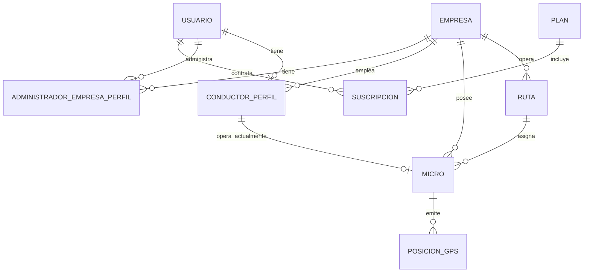

# Modelo de datos

> **Estado:** implementado en `go-tacna-backend/gotacna-backend-core/database/migrations/`.
> **Fuente ERD:** [`../diagramas/fuente/modelo-entidad-relacion.mmd`](../diagramas/fuente/modelo-entidad-relacion.mmd)
> **Relacionado:** [`../gotacna-backend-core.md`](../gotacna-backend-core.md), [`arquitectura.md`](arquitectura.md)

## Alcance

El dominio se compone de 9 tablas:

1. `usuarios`
2. `empresas`
3. `administrador_empresa_perfiles`
4. `conductor_perfiles`
5. `rutas`
6. `micros`
7. `posiciones_gps`
8. `planes`
9. `suscripciones`

Todas tienen `created_at` y `updated_at` (timestamps nullable de Laravel). No se usan soft deletes.

Las migraciones base de Laravel (`users`, `password_reset_tokens`, `sessions`, `cache`, `cache_locks`, `jobs`, `job_batches`, `failed_jobs`) se conservan como andamiaje del framework. **La API no usa `users`**: la autenticación y las relaciones de dominio se resuelven contra `usuarios`.

## Tablas

### `usuarios`

| Columna | Tipo | Nulo | Notas |
|---|---|---|---|
| `id` | bigint unsigned | No | PK autoincremental |
| `dni` | varchar(20) | No | Único |
| `nombre` | varchar(255) | No | |
| `apellido` | varchar(255) | No | |
| `correo` | varchar(255) | No | Único; credencial de login |
| `telefono` | varchar(30) | No | |
| `password_hash` | varchar(255) | No | Hash de contraseña; oculto en respuestas |
| `rol` | enum | No | `pasajero`, `conductor`, `admin_general`, `admin_empresa`; default `pasajero` |
| `activo` | boolean | No | Default `true` |
| `created_at`, `updated_at` | timestamp | Sí | |

Restricciones: PK `id`; unique `dni`; unique `correo`; índice `(rol, activo)`.

### `empresas`

| Columna | Tipo | Nulo | Notas |
|---|---|---|---|
| `id` | bigint unsigned | No | PK autoincremental |
| `ruc` | varchar(11) | No | Único |
| `razon_social` | varchar(255) | No | |
| `telefono` | varchar(30) | No | |
| `direccion` | varchar(255) | No | |
| `activo` | boolean | No | Default `true` |
| `created_at`, `updated_at` | timestamp | Sí | |

Restricciones: PK `id`; unique `ruc`.

### `administrador_empresa_perfiles`

| Columna | Tipo | Nulo | Notas |
|---|---|---|---|
| `id` | bigint unsigned | No | PK autoincremental |
| `usuario_id` | bigint unsigned | No | FK `usuarios.id`, `ON DELETE CASCADE` |
| `empresa_id` | bigint unsigned | No | FK `empresas.id`, `ON DELETE CASCADE` |
| `cargo` | varchar(255) | Sí | Ej. Gerente, Supervisor |
| `created_at`, `updated_at` | timestamp | Sí | |

Restricciones: PK `id`; unique `(usuario_id, empresa_id)`.

Un `admin_empresa` puede estar vinculado a varias empresas y una empresa puede tener varios administradores.

### `conductor_perfiles`

| Columna | Tipo | Nulo | Notas |
|---|---|---|---|
| `id` | bigint unsigned | No | PK autoincremental |
| `usuario_id` | bigint unsigned | No | FK `usuarios.id`, `ON DELETE CASCADE`; único |
| `empresa_id` | bigint unsigned | No | FK `empresas.id`, `ON DELETE RESTRICT` |
| `licencia_conducir` | varchar(255) | No | |
| `estado_operativo` | enum | No | `disponible`, `en_recorrido`, `sin_conexion`; default `sin_conexion` |
| `created_at`, `updated_at` | timestamp | Sí | |

Restricciones: PK `id`; unique `usuario_id`; índice `(empresa_id, estado_operativo)`.

Un usuario tiene como máximo un perfil de conductor.

### `rutas`

| Columna | Tipo | Nulo | Notas |
|---|---|---|---|
| `id` | bigint unsigned | No | PK autoincremental |
| `empresa_id` | bigint unsigned | No | FK `empresas.id`, `ON DELETE RESTRICT` |
| `nombre_ruta` | varchar(255) | No | |
| `trazado_ruta` | geometry(LineString, 4326) / JSON | Sí | PostGIS en PostgreSQL; JSON en SQLite/otros |
| `activo` | boolean | No | Default `true` |
| `created_at`, `updated_at` | timestamp | Sí | |

Restricciones: PK `id`; unique `(empresa_id, nombre_ruta)`; índice GiST `rutas_trazado_ruta_gist` sobre `trazado_ruta` en PostgreSQL.

En PostgreSQL la migración exige que la extensión PostGIS esté habilitada. El trazado no está en `$fillable`: se escribe con `Ruta::guardarTrazado()` y se lee como GeoJSON mediante `trazado_ruta_geojson`.

### `micros`

| Columna | Tipo | Nulo | Notas |
|---|---|---|---|
| `id` | bigint unsigned | No | PK autoincremental |
| `empresa_id` | bigint unsigned | No | FK `empresas.id`, `ON DELETE RESTRICT` |
| `ruta_id` | bigint unsigned | Sí | FK `rutas.id`, `ON DELETE SET NULL` |
| `conductor_actual_id` | bigint unsigned | Sí | FK `conductor_perfiles.id`, `ON DELETE SET NULL`; único |
| `placa` | varchar(20) | No | Única |
| `capacidad_pasajeros` | smallint unsigned | No | Default 20 |
| `estado` | enum | No | `disponible`, `en_recorrido`, `mantenimiento`, `inactivo`; default `disponible` |
| `created_at`, `updated_at` | timestamp | Sí | |

Restricciones: PK `id`; unique `placa`; unique `conductor_actual_id`; índice `(empresa_id, estado)`; índice `(ruta_id, estado)`.

No existe una columna `activo` separada: el estado `inactivo` cumple esa función. Un conductor no puede estar asignado a dos micros a la vez.

### `posiciones_gps`

| Columna | Tipo | Nulo | Notas |
|---|---|---|---|
| `id` | bigint unsigned | No | PK autoincremental |
| `micro_id` | bigint unsigned | No | FK `micros.id`, `ON DELETE CASCADE` |
| `latitud` | decimal(10,8) | No | |
| `longitud` | decimal(11,8) | No | |
| `velocidad` | float | No | Default 0 |
| `fecha_hora` | timestamp | No | Momento de la lectura |
| `created_at`, `updated_at` | timestamp | Sí | |

Restricciones: PK `id`; índice `(micro_id, fecha_hora)`.

### `planes`

| Columna | Tipo | Nulo | Notas |
|---|---|---|---|
| `id` | bigint unsigned | No | PK autoincremental |
| `nombre_plan` | varchar(255) | No | Único |
| `costo` | decimal(10,2) | No | Default 0 |
| `activo` | boolean | No | Default `true` |
| `created_at`, `updated_at` | timestamp | Sí | |

Restricciones: PK `id`; unique `nombre_plan`.

### `suscripciones`

| Columna | Tipo | Nulo | Notas |
|---|---|---|---|
| `id` | bigint unsigned | No | PK autoincremental |
| `usuario_id` | bigint unsigned | No | FK `usuarios.id`, `ON DELETE RESTRICT`; en la creación administrativa debe ser pasajero |
| `plan_id` | bigint unsigned | No | FK `planes.id`, `ON DELETE RESTRICT` |
| `fecha_inicio` | date | No | |
| `fecha_vencimiento` | date | No | Debe ser igual o posterior a `fecha_inicio` |
| `estado` | enum | No | `activa`, `vencida`, `cancelada`; default `activa` |
| `created_at`, `updated_at` | timestamp | Sí | |

Restricciones: PK `id`; índice `(usuario_id, estado)`; índice `(plan_id, estado)`.

## Relaciones

Lectura de las cardinalidades:

- Un `USUARIO` puede tener cero o un `CONDUCTOR_PERFIL`; un perfil pertenece a un solo usuario.
- Un `USUARIO` puede administrar varias empresas; la tabla pivote `ADMINISTRADOR_EMPRESA_PERFIL` materializa el N:M.
- Un `CONDUCTOR_PERFIL` puede operar como máximo un `MICRO` a la vez (`conductor_actual_id` único). Un micro puede no tener conductor.
- Un `MICRO` puede no tener ruta (`ruta_id` nullable).
- Una `EMPRESA` tiene muchas rutas, micros, conductores y administradores.
- Un `PLAN` tiene muchas suscripciones; una `SUSCRIPCION` pertenece a un usuario y a un plan.

## Reglas de integridad y borrado

- `empresas` no se elimina si tiene rutas, micros, conductores o administradores. La API devuelve `409`; las FK usan `RESTRICT`.
- `rutas` no se elimina si tiene micros asignados (`409`).
- `micros` no se elimina si está `en_recorrido` (`409`); al eliminarlo, sus posiciones se borran en cascada.
- `conductor_perfiles` no se elimina si tiene un micro asignado (`409`). Al eliminar el usuario, el perfil se borra en cascada.
- `planes` no se elimina si tiene suscripciones (`409`).
- `usuarios` no se elimina si tiene perfiles/suscripciones o si es el usuario autenticado (`409`); no se puede desactivar la propia cuenta (`422`).
- Al eliminar una ruta o un conductor, `micros.ruta_id` o `micros.conductor_actual_id` quedan en `NULL` (`SET NULL`).
- Los estados se validan en la capa de aplicación además del enum de base de datos.

## Diferencias entre PostgreSQL y SQLite

- `rutas.trazado_ruta` es `geometry(LineString, 4326)` en PostgreSQL y JSON en SQLite. La API siempre lo expone como GeoJSON.
- SQLite no aplica todas las restricciones de tipo ni los `ENUM` de PostgreSQL; las pruebas Feature validan las reglas en la capa de aplicación.
- Las pruebas usan SQLite en memoria (`phpunit.xml`). Para validar PostGIS hay que ejecutar las migraciones contra el PostgreSQL del Compose.

## Datos de demostración

El `DatabaseSeeder` crea:

- 2 empresas: Transportes Tacna S.A.C. y Rutas del Sur E.I.R.L.
- 5 usuarios: 1 `admin_general`, 1 `admin_empresa`, 2 conductores y 1 pasajero.
- 1 vínculo de administrador de empresa, 2 perfiles de conductor.
- 2 rutas con trazado GeoJSON, 2 micros, 2 posiciones GPS.
- 3 planes y 1 suscripción activa.

Credenciales de desarrollo:

| Rol | Correo | Contraseña |
|---|---|---|
| `admin_general` | `admin@gotacna.pe` | `admin123` |
| `admin_empresa` | `admin.empresa@gotacna.pe` | `empresa123` |
| `conductor` | `conductor1@gotacna.pe` | `conductor123` |
| `conductor` | `conductor2@gotacna.pe` | `conductor123` |
| `pasajero` | `pasajero@gotacna.pe` | `pasajero123` |

No reutilices estas credenciales en producción.

## Cómo cambiar el modelo

1. Crea una migración nueva con `php artisan make:migration`; no edites migraciones ya aplicadas en entornos compartidos.
2. Actualiza el modelo, las relaciones, los Resources, los FormRequests y las pruebas.
3. Actualiza este documento y el ERD de [`../diagramas/fuente/modelo-entidad-relacion.mmd`](../diagramas/fuente/modelo-entidad-relacion.mmd).
4. Si cambia el contrato de la API, actualiza [`../contratos/openapi.yaml`](../contratos/openapi.yaml).
5. Ejecuta `php artisan migrate:fresh --seed` en SQLite y, si está disponible, en PostgreSQL/PostGIS.
