# Mapa del sitio

> **Estado:** En revisión
> **Responsable:** Alex Huaracha
> **Relacionado:** [alcance por perfil](alcance-por-perfil.md), [inventario de vistas](inventario-de-vistas.md), [Figma](figma.md), [T091](https://github.com/tuChaski/go-tacna-frontend/issues/52)

## 1. Qué representa

El mapa muestra cómo se organizan las pantallas de Go Tacna y qué puede encontrar cada perfil. Comprende la web pública, la administración web y la app Android con consulta de pasajero y Modo Conductor.

La separación principal es entre el administrador general, que gestiona la plataforma y los accesos de las empresas, y el administrador de empresa, que organiza su propia flota. Las funciones y decisiones pendientes se detallan en [alcance por perfil](alcance-por-perfil.md).

El árbol representa la organización prevista, no una lista de funciones ya terminadas. Las líneas discontinuas indican ampliaciones de interfaz pendientes. Las demás ramas pueden estar implementadas en web o representadas solamente en Figma; el estado de cada vista se consulta en el inventario.

## 2. Diagrama general

El diagrama se incluye en SVG para poder ampliarlo sin perder legibilidad. Su [fuente editable](../diagramas/fuente/mapa-del-sitio.mmd) se mantiene en Mermaid. El PNG anterior de `diagramas/export/mapa-del-sitio.png` corresponde a la versión previa y no se usa como evidencia de este mapa actualizado.

## 3. Organización de la administración

| Entrada | Organización prevista | Situación actual |
|---|---|---|
| Administrador general | Inicio → Empresas → Detalle de empresa → Cuentas administrativas; ampliaciones de Pasajeros, Premium y supervisión general | `/admin` redirige a `/admin/empresas`; Empresas y sus cuentas tienen interfaz conectada a la API |
| Administrador de empresa | Empresa autorizada → Inicio de flota → Rutas, Micros, Conductores y Monitoreo | `/admin/empresa` redirige a Rutas; hay selección de empresa y CRUD; faltan dashboard operativo y monitoreo conectado |
| Micros | Listado → Registro, detalle o edición → Ruta y conductor asignados | La asignación se gestiona desde Micros; puede variar entre jornadas |
| Conductores | Listado → Registro con credenciales, detalle o edición | El alta incluye la cuenta; la edición web actual permite modificar la licencia, no todos los datos de la cuenta |

Las rutas `/admin/rutas`, `/admin/micros` y `/admin/conductores` del mapa anterior eran propuestas. Las rutas existentes de empresa son `/admin/empresa/rutas`, `/admin/empresa/micros` y `/admin/empresa/conductores`. El inventario conserva los identificadores de esas vistas y corrige sus direcciones.

Los módulos futuros se añaden cuando tengan pantallas y permisos definidos. No se incluyen botones sin acción ni opciones de otra empresa en el menú operativo.

## 4. Organización del pasajero y del conductor

| Área | Contenido y acceso |
|---|---|
| Web pública | Inicio, consulta pública de rutas y mapa; acceso a registro e inicio de sesión |
| Entrada de la app | Continuar como invitado o iniciar sesión; el registro público crea una cuenta de pasajero |
| Consulta del pasajero | Mapa → Seleccionar ruta → Seleccionar micro → Ver ubicación; detalle, trazado, punto de espera y tiempo estimado de llegada |
| Cuenta de pasajero | Perfil y favoritos del diseño existente; historial previsto con conservación limitada |
| Premium | Ampliación futura de capacidad de consulta e historial; ocupación como idea posterior con fuente de datos por definir |
| Modo Conductor | Acceso con credenciales de empresa → Revisar asignación → Iniciar recorrido → Recorrido activo → Finalizar |

Una misma app ofrece la consulta de pasajero y el Modo Conductor. La cuenta determina el acceso; el conductor no se registra eligiendo ese rol en el formulario público.

Los máximos de micros, trazados visibles y días de historial quedan pendientes. No se aplica como nueva regla el límite de dos micros del prototipo anterior. Se conservan los [resultados históricos de T054](../pruebas/informes/t054-pruebas-usabilidad-figma.md) y se deberá actualizar el diseño cuando se acuerden los cupos.

## 5. Flujos principales

| Objetivo | Recorrido |
|---|---|
| Dar acceso a una empresa | General → Empresas → Registrar → Guardar empresa → Detalle → Crear cuenta administrativa → Guardar cuenta |
| Preparar una flota | Empresa → Registrar ruta → Registrar conductor y credenciales → Registrar micro → Asignar ruta y conductor |
| Cambiar el conductor del día | Empresa → Micros → Detalle → Editar → Elegir conductor → Revisar cambio propuesto → Guardar; el micro debe estar fuera de recorrido |
| Consultar la flota | Empresa → Monitoreo → Filtrar por ruta o estado → Seleccionar micro; flujo pendiente de integración web |
| Consultar un micro como pasajero | Mapa principal → Ruta → Micro → Ver ubicación; acceso básico también como invitado |
| Consultar al conductor | Detalle del micro → Información del conductor actual; apartado nuevo pendiente de diseño |
| Iniciar y finalizar la operación | Modo Conductor → Revisar asignación → Iniciar y confirmar → Recorrido activo → Finalizar y confirmar |

La regla de tres toques se aplica desde el mapa principal hasta la ubicación del micro: Ruta → Micro → Ver ubicación. No incluye el registro ni el inicio de sesión. La referencia del diseño se encuentra en [T093](flujo-navegacion-pasajero.md).

## 6. Reglas de navegación y estados

- El inicio de sesión dirige al panel según el rol. El menú no concede permisos por sí mismo.
- El administrador de empresa solo consulta y modifica recursos de sus empresas autorizadas. Si tiene varias, el nombre de la seleccionada permanece visible.
- Las pantallas ofrecen una salida al listado o al mapa de origen; cancelar un formulario no anuncia un guardado.
- Se muestran estados de carga, lista vacía, error y acción pendiente. No se anuncia éxito mientras el servidor no lo confirma.
- Se distinguen cuenta desactivada, micro fuera de recorrido y falta de señal; no son el mismo estado.
- Un micro sin asignación válida no permite iniciar recorrido. Un micro en recorrido no permite reasignación de conductor o ruta.
- Una ubicación antigua conserva la indicación de última actualización; no se presenta como seguimiento en vivo y no ofrece un ETA calculado como si fuera actual.
- No se incluyen navegación de compra, medios de pago ni cobro de pasajes o de Premium.

## 7. Uso en la sección 1.8 y revisión pendiente

Este documento desarrolla el mapa de la sección 1.8; el [inventario](inventario-de-vistas.md) aporta el detalle de las pantallas. Aprovecha la base de T083 y la amplía para T091, sin crear una segunda numeración de vistas.

Para el informe final se utiliza el diagrama actualizado y un resumen de la separación de perfiles, junto con la referencia al inventario. La carpeta del informe consolidado todavía no existe; su integración y la aprobación de T091 siguen pendientes. La numeración de figuras y tablas se asigna al consolidar ese informe.

La revisión de esta entrega comprende documentos y código. No constituye una nueva prueba del prototipo, del servidor ni de Android. Los cambios futuros de Figma y las nuevas cuotas requieren su propia validación.
